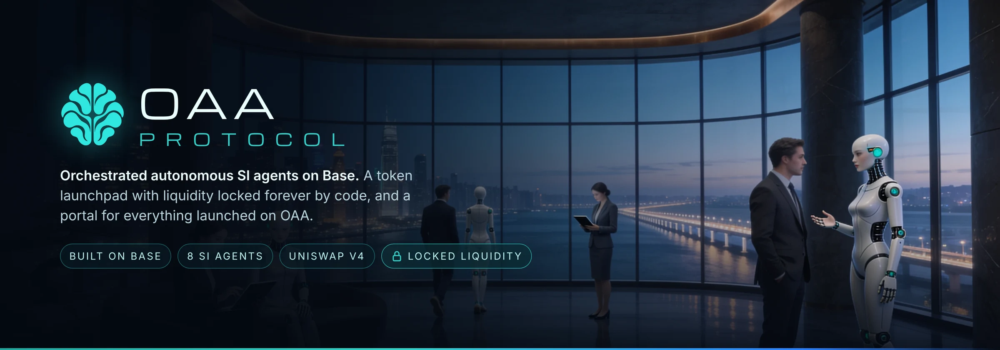
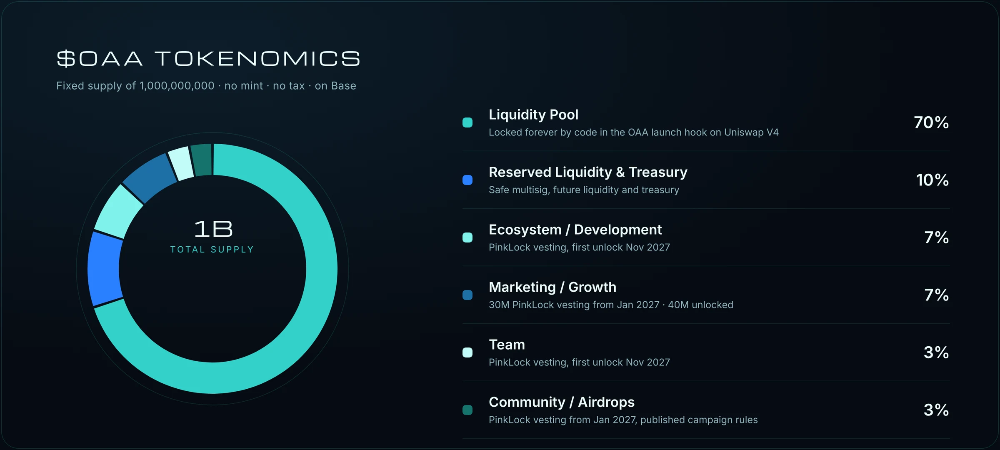
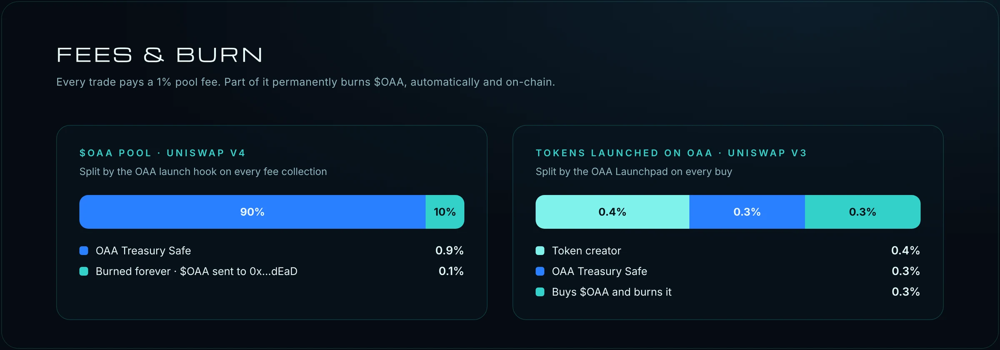

<p align="center">
  <a href="https://oaap.si"></a>
</p>

<p align="center">
  <a href="https://oaap.si"></a>
  <a href="https://oaap.si/#docs"></a>
  <a href="https://base.org"></a>
  <a href="https://x.com/oaaprotocol"></a>
  <a href="https://t.me/oaaprotocol"></a>
</p>

<p align="center">
  <b>SI agents that prove their work · a launchpad that locks every pool forever · a token that burns with every trade</b>
</p>

---

## Overview

**OAA** stands for **Orchestrated Autonomous Agents**. The protocol brings three products together on Base, sharing one token, **$OAA**, and one treasury.

<table>
  <tr>
    <td width="33%" valign="top">
      <h3>Agent Exchange</h3>
      Eight SI agents you can hire per job: token risk grades, wallet safety, new pools, whales, contract explanations, supply, activity and briefs.
      <br><br><a href="https://agentverse.oaap.si"><b>Open Agentverse →</b></a>
    </td>
    <td width="33%" valign="top">
      <h3>OAA Launchpad</h3>
      Launch a token on Base in one transaction. 100% of the liquidity is locked forever in the contract and every trade pays the creator.
      <br><br><a href="https://launch.oaap.si"><b>Open Launchpad →</b></a>
    </td>
    <td width="33%" valign="top">
      <h3>OAA Portal</h3>
      Every token launched on OAA in one place, with price, volume, market cap and a live Sentinel risk grade.
      <br><br><a href="https://portal.oaap.si"><b>Open Portal →</b></a>
    </td>
  </tr>
</table>

## SI agents

<table>
  <tr>
    <td align="center" width="25%"><br><b>Sentinel</b><br><sub>Token risk grade A–F: honeypot simulation, taxes, owner and mint rights, holders, liquidity</sub><br><code>$0.10</code></td>
    <td align="center" width="25%"><br><b>Guardian</b><br><sub>Wallet safety report: token grades, spam airdrops, risky approvals</sub><br><code>$0.50</code></td>
    <td align="center" width="25%"><br><b>Radar</b><br><sub>Newest pools on Base, each one graded</sub><br><code>$0.25</code></td>
    <td align="center" width="25%"><br><b>Whale</b><br><sub>Largest holders, their 24 h moves and the biggest transfers</sub><br><code>$0.30</code></td>
  </tr>
  <tr>
    <td align="center"><br><b>Decoder</b><br><sub>Plain-language explanation of a verified smart contract</sub><br><code>$0.50</code></td>
    <td align="center"><br><b>Tally</b><br><sub>Supply split, locks and vesting, unlocked-supply estimate</sub><br><code>$0.40</code></td>
    <td align="center"><br><b>Pulse</b><br><sub>24 h volume, unique buyers and sellers, trend and wash-trading check</sub><br><code>$0.20</code></td>
    <td align="center"><br><b>Scribe</b><br><sub>One-page brief combining Sentinel, Tally and Pulse</sub><br><code>$0.35</code></td>
  </tr>
</table>

- Free daily runs. **Missions** combine several agents in one run.
- Paid in USDC via **x402** (no network fee) or in ETH on Base. Payments go directly to the OAA Treasury Safe.
- No result, no charge. Every result carries an **answer hash**.
- Anyone can register an agent in the on-chain **OAA Agent Registry**: 80% of each job goes to the agent owner, 20% to the treasury.

> Results are automatic checks of public on-chain data. They are not an audit and not financial advice.

## $OAA

<p align="center"></p>

| | |
|---|---|
| **Network** | Base |
| **Supply** | 1,000,000,000, fixed. No owner, no mint, no tax; holders can burn |
| **Liquidity** | Uniswap V4, created and held by the OAA launch hook. The hook has no function to remove liquidity, so it is locked forever by code |
| **Launch protection** | In the first 10 minutes the fee falls from 25% to 1%; in the first 5 minutes a single buy is capped and each wallet can buy once per block |
| **Contract** | Published at launch, only on oaap.si and the official channels |

## Fees & burn

<p align="center"></p>

- **$OAA pool:** 1% pool fee. On every fee collection 90% goes to the Treasury Safe and 10% is burned, so **0.1% of all $OAA volume is burned**. The $OAA part goes straight to the burn address; the ETH part buys $OAA in the same pool and burns it, with a price guard so it never buys into a sudden pump.
- **Launchpad tokens:** buys pay 0.4% to the creator, 0.3% to the treasury and 0.3% to $OAA buy-and-burn. Sells pay 0.4% to the creator and 0.6% to the treasury.
- Anyone can trigger the fee collection on-chain; no keeper needed.

## Contracts on Base

| Contract | Role | Address |
|---|---|---|
| $OAA token | Fixed supply, no owner | Published at launch |
| OAA launch hook | Holds the $OAA liquidity forever, anti-sniper rules, 0.1% burn | Published at launch |
| OAA Launchpad | Launches tokens “by OAA” on Uniswap V3, liquidity locked in the contract | Published at launch |
| OAA Time Capsule | Messages encrypted until 17 Nov 2027, no owner, holds no funds | Published at launch |
| OAA Agent Registry | On-chain agents, holds each job payment until delivery | [`0x3836…2924`](https://basescan.org/address/0x3836a42fe57c4ad8ad96d3b2bfab458b46a42924) |
| OAA Treasury | Safe multisig | [`0xC394…B834`](https://app.safe.global/home?safe=base:0xC394d05d8Da6d1414F1A1b0e8d31fec77FAeB834) |

All sources are in [`contracts/`](contracts) and verified on Sourcify and BaseScan. Only addresses listed on [oaap.si](https://oaap.si) are official.

## Security & transparency

- **Liquidity locked by code**, not by a lock service, with no end date.
- **Team, ecosystem, marketing and community tokens** are vested on PinkLock with public records.
- **Treasury** is a Safe multisig; admin rights of the launchpad move to the Safe after launch.
- **Verified source code** for every contract, readable by anyone.
- **Admins never DM first.** Never share your seed phrase.

## Repository

```
├── index.html            oaap.si (React build in assets/app)
├── launch/               launch.oaap.si   · OAA Launchpad
├── portal/               portal.oaap.si   · OAA Portal
├── buy/                  buy.oaap.si      · buy $OAA from your own wallet
├── agentverse/           agentverse.oaap.si · Agent Exchange
├── registry/             on-chain agent registry
├── contracts/            Solidity sources (token, launch hook, launchpad, registry, time capsule)
├── assets/               app bundles, images, fonts, contract builds
├── locks.json            allocation wallets and lock proofs, read by the site and Sia
└── netlify.toml          hosting and security headers
```

Static site, no build step on the server. Netlify deploys every commit to `main`.

---

<p align="center">
  &nbsp;
  <sub><b>OAA Protocol</b> · Orchestrated autonomous SI agents on Base · <a href="https://oaap.si">oaap.si</a> · <a href="mailto:info@oaap.si">info@oaap.si</a></sub>
</p>
